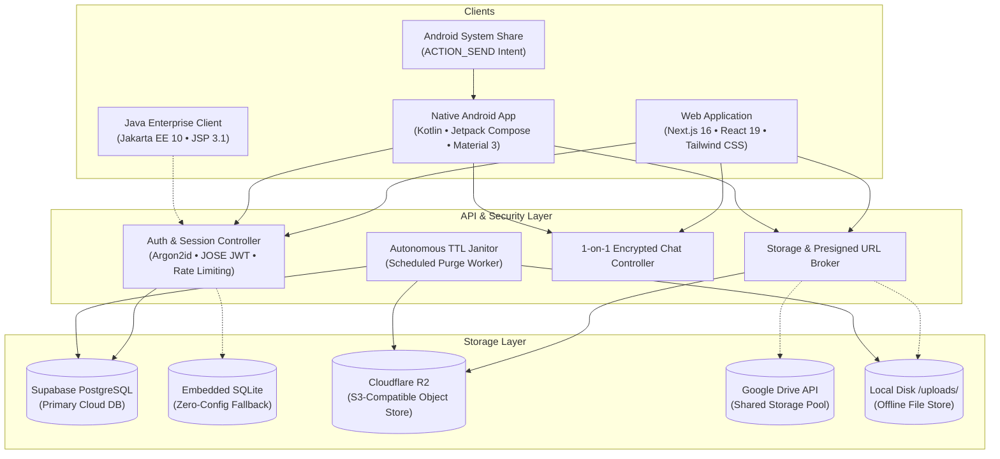

<p align="center">
  <a href="https://gsend.in">
    
  </a>
</p>

<h1 align="center">Global Send</h1>

<p align="center">
  <strong>Your stuff. Everywhere. Instantly and ephemerally.</strong><br>
  A private, minimalist cross-device cloud locker, clipboard bridge, and encrypted messenger with guaranteed auto-disintegration.
</p>

<p align="center">
  <a href="https://gsend.in"></a>
  <a href="https://github.com/ayushagnihotrii/global-send"></a>
  <a href="#-technology-stack"></a>
  <a href="#-native-android-client"></a>
  <a href="#-java-enterprise-edition"></a>
  
</p>

<p align="center">
  <a href="#-key-features">Features</a> •
  <a href="#-ecosystem-overview">Ecosystem</a> •
  <a href="#-system-architecture">Architecture</a> •
  <a href="#-technology-stack">Tech Stack</a> •
  <a href="#-getting-started-locally">Getting Started</a> •
  <a href="#-security--privacy-architecture">Security</a> •
  <a href="#-production-deployment">Deployment</a>
</p>

---

## 💡 Overview

**Global Send** (`gsend.in`) solves the friction of moving text, code snippets, photos, links, and documents across phones, tablets, and computers. 

Instead of emailing yourself, pinging personal messaging apps, or dealing with heavy cloud sync software, Global Send provides a **zero-tracking, instant web and native mobile locker**. Everything you save is available on any browser with a single click, features 1-tap verbatim clipboard copying, and automatically disintegrates according to your chosen TTL timer.

Inspired by **Apple Notes** and **Apple Settings** design principles: minimal typography, 8pt spatial grid, smooth rounded cards, fluid micro-interactions, and high-readability dark mode.

---

## ✨ Key Features

### ⚡ Frictionless Phone-to-Desktop Workflow
- **Save on mobile, copy on desktop in seconds**: Highlight any exam problem, terminal command, or code snippet on your phone and open Global Send on any computer.
- **Verbatim Clipboard Copy**: 1-click copy strictly preserves formatting, tabs, newlines, indents, and Unicode characters without truncation.
- **Dedicated Monospace Reader**: Built-in toggle optimized for inspecting programming code, bash scripts, and technical notes.

### ⏱️ Ephemeral Storage & Guaranteed Auto-Disintegration (TTL)
- Configurable item lifespans: **1 hour**, **6 hours**, **12 hours**, **24 hours** (default), **3 days**, or **7 days**.
- Autonomous background janitor cleans expired items, physical files, and storage objects reliably.

### 💬 Built-in 1-on-1 Encrypted Messenger
- Exchange direct messages and attach vault items directly to any Global Send user.
- Contact privacy, block/unblock capabilities, and realtime chronological message timelines.

### 🛡️ Zero-Tracking Authentication & Anti-Enumeration Recovery
- **Username + Private Key**: No phone numbers, no emails, no invasive verification.
- **Argon2id Salted Hashing**: High-memory-cost key verification with constant-time dummy verification for non-existent users (prevents timing attacks).
- **Anti-Enumeration Security Questions**: Requests for non-existent usernames return deterministic HMAC-SHA-256 decoy questions.
- **Persistent Abuse Protection**: 5 consecutive failed recovery attempts trigger an exponential lockout (30 minutes up to 24 hours), surviving serverless container restarts.
- **Session Revocation**: Password/key resets immediately increment `session_version`, instantaneously invalidating all active JWT tokens across all devices.

### 📁 Multi-Engine Cloud & Local Storage
- **Cloudflare R2**: Fast, egress-free S3-compatible cloud bucket storage with presigned direct client uploads.
- **Google Drive Integration**: OAuth-backed storage pool option with automatic folder routing.
- **Zero-Config Local Fallback**: Instant local disk storage and embedded SQLite database for 100% offline development.

### 📱 100% Native Jetpack Compose Android Client
- Complete native app matching the web design token system (`#CDFF5D` neon lime, `#FC6742` coral, `#C17BF3` purple).
- Intercepts native Android **`ACTION_SEND`** / **`ACTION_SEND_MULTIPLE`** intents from any app (Chrome, Gallery, Files).
- Hardware-backed biometric authentication (Fingerprint / Face Unlock) using `Android Keystore` and `EncryptedSharedPreferences`.

---

## 🏛️ Ecosystem Overview

Global Send is structured as a complete multi-client, multi-backend ecosystem:

```
global-send/
├── src/                 # Next.js 16 Web Application (App Router + React 19)
│   ├── app/             # Modern App Router Pages & REST API Endpoints
│   ├── components/      # Apple HIG-inspired UI Components & Views
│   ├── config/          # Site parameters, presets, and expiration policies
│   └── lib/             # DB client, crypto, storage engines (R2, Drive, Local)
├── android/             # Native Android Application (Kotlin 2.0 + Jetpack Compose)
│   ├── app/src/main/    # Compose UI, ViewModels, Room DB, Retrofit Networking
│   └── build.gradle.kts # Android Gradle build configuration
├── globalsend-java/     # Enterprise Advanced Java Application (Jakarta EE 10)
│   ├── src/main/java/   # Servlets 6.0, JSP 3.1, DAO Pattern, NIO, HikariCP
│   └── pom.xml          # Maven enterprise build specification
├── supabase/            # PostgreSQL schemas, functions, and database migrations
├── public/              # Branding assets, web icons, stickers, and logos
└── docs/                # Architecture audits and integration guides
```

---

## 🏗️ System Architecture



---

## 🛠️ Technology Stack

| Layer | Technologies | Highlights |
| :--- | :--- | :--- |
| **Web Frontend** | Next.js 16, React 19, TypeScript, Tailwind CSS v4 | Server Components, Turbopack, dark/light theme tokens, Lucide icons |
| **Android Client** | Kotlin 2.0, Jetpack Compose, Material 3, Room, Retrofit | MVVM architecture, BiometricPrompt, EncryptedSharedPreferences |
| **Enterprise Server** | Java 21 LTS, Jakarta EE 10, Servlets 6.0, JSP 3.1, HikariCP | Strict MVC & DAO patterns, Java NIO.2 file handling, ScheduledExecutor |
| **Authentication** | Argon2id, PBKDF2, JOSE (JWT), Secure HTTP-only cookies | Timing-safe verification, HMAC fake questions, 5-attempt persistent lock |
| **Databases** | PostgreSQL (`pg`), Supabase, SQLite (`@libsql/client`) | Auto-switching failover: cloud PostgreSQL or zero-config local SQLite |
| **Object Storage** | Cloudflare R2 (`@aws-sdk/client-s3`), Google Drive API, Local FS | Direct client-to-R2 presigned PUT/GET, mime validation, zero-leak links |
| **Deployment** | Vercel (Edge & Serverless), Cloudflare DNS, Custom Domain (`gsend.in`) | Automated CI/CD, SSL Full (Strict), custom DNS routing |

---

## 🚀 Getting Started Locally

Global Send is designed to work **out of the box** for local testing with zero external cloud dependencies.

### 1. Prerequisites
- **Node.js** >= 18.x
- **npm** or **pnpm**
- *(Optional for Android)* **Android Studio Hedgehog+** & **JDK 17/21**
- *(Optional for Java)* **JDK 21 LTS** & **Apache Maven 3.9+**

### 2. Clone the Repository
```bash
git clone https://github.com/ayushagnihotrii/global-send.git
cd global-send
```

### 3. Install Web Dependencies
```bash
npm install
```

### 4. Configure Environment
```bash
cp .env.example .env.local
```
> [!TIP]
> **Zero-Config Ready**: If you leave `DATABASE_URL` empty, Global Send automatically provisions an embedded SQLite database in `.data/quickvault.db` and writes uploads to local disk `.data/uploads/`.

### 5. Launch the Development Server
```bash
npm run dev -- --port 3000
```
Open **[http://localhost:3000](http://localhost:3000)** in your browser.

---

## 📱 Native Android Client

The native Android application is located in [`android/`](file:///d:/fun%20projects/global%20send/android).

### Build Debug APK
```bash
cd android
# Windows:
.\gradlew.bat assembleDebug

# macOS / Linux:
./gradlew assembleDebug
```
The compiled APK will be output to:
`android/app/build/outputs/apk/debug/app-debug.apk`

### Install onto Device / Emulator
```bash
adb install -r android/app/build/outputs/apk/debug/app-debug.apk
```

### Backend Host Settings
- **Android Emulator**: Set backend URL to `http://10.0.2.2:3000`
- **Physical Device**: Set backend URL to your computer's LAN IP (`http://192.168.x.x:3000`) or production `https://gsend.in`

---

## ☕ Java Enterprise Edition

The standalone enterprise Java web application is located in [`globalsend-java/`](file:///d:/fun%20projects/global%20send/globalsend-java).

```bash
cd globalsend-java

# Run with embedded Tomcat
mvn clean compile exec:java

# Or build production WAR for Tomcat/WildFly
mvn clean package
```

Features:
- Self-contained embedded Apache Tomcat 10.1
- Dual Database failover (MySQL 8.0 with HikariCP, falling back to SQLite)
- Autonomous background cleanup daemon with `ScheduledExecutorService`

---

## 🔐 Security & Privacy Architecture

```
                  ┌────────────────────────┐
                  │ Client / Mobile Device │
                  └───────────┬────────────┘
                              │
                    Username + Private Key
                              │
                              ▼
        ┌───────────────────────────────────────────┐
        │   Timing-Safe Constant-Time Verification  │
        │   - Real User: Verify Salted Argon2id     │
        │   - Fake User: Verify Salted Dummy Hash   │
        └─────────────────────┬─────────────────────┘
                              │
               ┌──────────────┴──────────────┐
               │                             │
        [ Valid Key ]                 [ Invalid / Fake ]
               │                             │
               ▼                             ▼
       Signed JOSE JWT               Generic 401 Response
    (HTTP-Only Lax Cookie)        "Invalid username or key."
```

1. **Anti-Enumeration by Design**: Non-existent usernames and incorrect secret keys return the exact same HTTP 401 error message and execute in constant cryptographic time.
2. **Decoy Recovery Questions**: Requesting the security question for an unknown user generates a deterministic fake question via HMAC-SHA-256 using a server secret, giving an attacker zero insight into whether an account exists.
3. **5-Attempt Exponential Lockout**: Rate limiting is tracked in the database and survives cold starts, locking out brute-force attacks after 5 failed attempts.
4. **Immediate Cryptographic Revocation**: Changing your security key increments `session_version`, invalidating every active session cookie and bearer token instantly.
5. **No Plaintext Passwords or Answers**: All secret keys and security answers are strictly normalized (Unicode NFKC, lowercased, whitespace collapsed) and hashed with Argon2id before storage.

---

## 🧪 Testing & Quality Assurance

Run the automated test suite across configuration, database, authentication, and security policies:

```bash
npm test
```

The test runner executes `test_config.mjs` and `test_globalsend.mjs`, covering:
- ✅ Username + Key authentication integrity & duplicate key collision safety
- ✅ Timing-safe constant-time verification & decoy HMAC question generation
- ✅ 2-step security question recovery and 5-strike rate limiting
- ✅ Presigned URL generation, file upload limits, and TTL expiration
- ✅ Cross-user data isolation and verbatim clipboard formatting preservation

---

## ☁️ Production Deployment

### 1. Deploy on Vercel
1. Fork or push this repository to your GitHub account.
2. Import the project in [Vercel](https://vercel.com).
3. Set the following environment variables:
   - `DATABASE_URL`: Your Supabase or PostgreSQL connection string
   - `DATABASE_SSL`: `true`
   - `JWT_SECRET`: Random 32+ character secret string (`openssl rand -base64 32`)
   - `R2_ACCOUNT_ID`, `R2_ACCESS_KEY_ID`, `R2_SECRET_ACCESS_KEY`, `R2_BUCKET_NAME` *(if using Cloudflare R2)*
   - `NEXT_PUBLIC_APP_URL`: `https://gsend.in`
4. Apply migrations: `supabase/migrations/004_security_questions_and_username_auth.sql`.
5. Deploy!

### 2. Custom Domain (`gsend.in`)
- Add `gsend.in` under **Vercel Project Settings → Domains**.
- Add the required CNAME or A record in your DNS provider (e.g., Cloudflare DNS).
- Ensure SSL/TLS encryption is set to **Full (Strict)**.

---

## 📄 License

This project is licensed under the [MIT License](file:///d:/fun%20projects/global%20send/LICENSE).

---

<p align="center">
  Crafted with precision by <a href="https://github.com/ayushagnihotrii"><strong>@ayushagnihotrii</strong></a>
</p>
<p align="center">
  <sub>Global Send • gsend.in • Your stuff. Everywhere.</sub>
</p>
