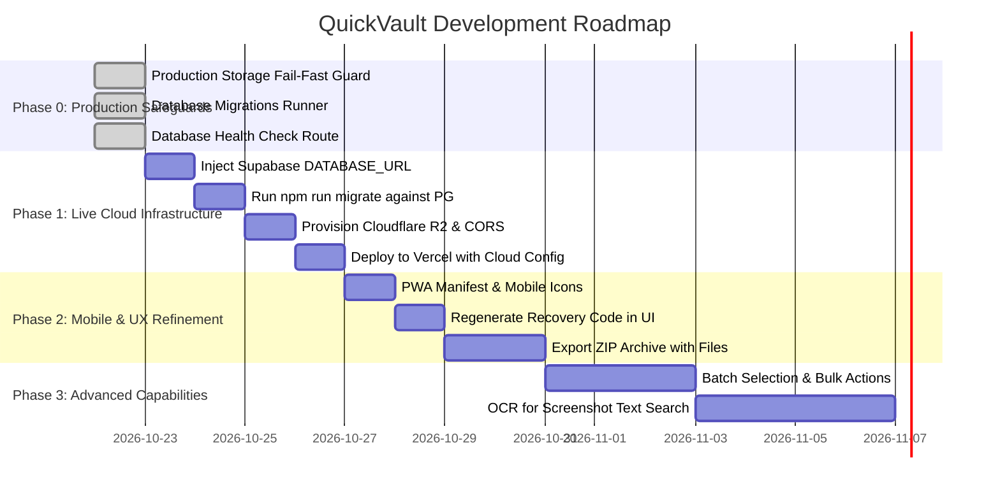

# QuickVault: Development Roadmap & Milestones

This roadmap outlines the verified milestones to transition QuickVault from its local staging state to full production deployment and advanced features.

---

## 1. Roadmap Overview & Timeline

---

## 2. Detailed Milestone Specifications

### Milestone 0: Production Storage Fail-Fast Safeguards (COMPLETED)
- **Status:** **DONE & VERIFIED**
- **Completed Tasks:**
  1. Created `src/lib/env-config.ts` enforcing strict validation of `DATABASE_URL` and Cloudflare R2 credentials.
  2. Throws `ConfigurationError` in production on missing/invalid credentials, preventing silent fallback to SQLite or local disk.
  3. Added 28 automated test assertions in `test_config.mjs` verifying development defaults and production failure modes.
  4. Blocked `/api/storage/local-upload` and `/api/storage/local-file` in production with HTTP 403 Forbidden.
  5. Implemented `deleteStorageFile()` in `src/lib/r2.ts` for consistent DB and storage deletion.
  6. Added `/api/health` checking active database health and reporting query latency.
  7. Added `scripts/migrate.mjs` tracking database migrations in `_migrations` table.

---

### Milestone 1: Production Cloud Infrastructure Activation (CURRENT PRIORITY)
- **Goal**: Transition from local embedded SQLite and filesystem storage to live Supabase PostgreSQL and Cloudflare R2.
- **Dependencies**: Supabase project created, Cloudflare R2 bucket provisioned.
- **Tasks**:
  1. Add `DATABASE_URL` and `DATABASE_SSL=true` into production environment variables.
  2. Run `npm run migrate` to apply `supabase/migrations/001_initial_schema.sql` to Supabase.
  3. Create private Cloudflare R2 bucket `quickvault` and apply documented CORS policy.
  4. Generate Cloudflare API token with Object Read & Write permissions; add `R2_ACCOUNT_ID`, `R2_ACCESS_KEY_ID`, `R2_SECRET_ACCESS_KEY`, and `R2_BUCKET_NAME` to environment variables.
  5. Deploy to Vercel/Node host and verify `/api/health` returns `status: "ok"` with `type: "postgres"`.
- **Measurable Acceptance Criteria**:
  - Live `/api/health` endpoint reports `database.ok: true` and `database.type: "postgres"`.
  - A user registers on the live domain; their record is saved to Supabase PostgreSQL.
  - A file uploaded from mobile or desktop is stored in Cloudflare R2 via presigned URL and served via secure signed GET URL.

---

### Milestone 2: PWA & Mobile Home-Screen Installation
- **Goal**: Make QuickVault installable on iOS Safari and Android Chrome as a standalone application.
- **Dependencies**: Milestone 1 complete.
- **Tasks**:
  1. Create `public/manifest.json` with app name, theme color `#f5f5f7`, background `#ffffff`, and standalone display mode.
  2. Create Apple touch icons (`apple-touch-icon.png`) and standard PWA icons (192×192 and 512×512 PNGs).
  3. Link manifest in `src/app/layout.tsx` headers.
- **Measurable Acceptance Criteria**:
  - Opening the website on an iPhone prompts or allows tapping "Add to Home Screen".
  - Launching the app opens in standalone mode without browser URL bars, maintaining full access to the bottom navigation bar and camera/file picker.

---

### Milestone 3: Full Vault Backup with Binary File Bundling
- **Goal**: Allow users to download a complete offline archive containing both metadata and all original binary files.
- **Dependencies**: Milestone 1 complete.
- **Tasks**:
  1. Add streaming ZIP archive generator endpoint (`/api/user/export-archive`).
  2. Read active files from R2 and append them into the ZIP alongside `metadata.json`.
- **Measurable Acceptance Criteria**:
  - Clicking "Export Complete Vault Archive" downloads a `.zip` file containing a clean `metadata.json` document and all active uploaded photos, PDFs, and videos in an `assets/` subfolder.
