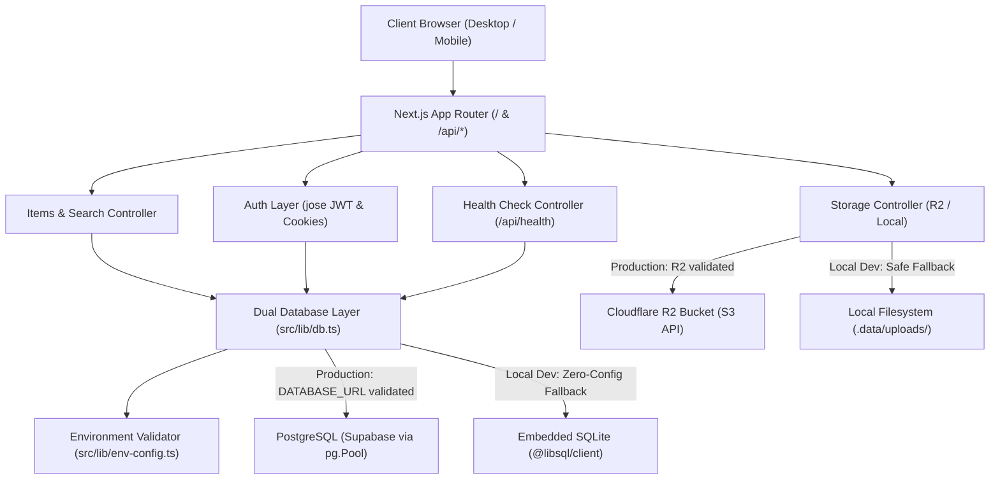
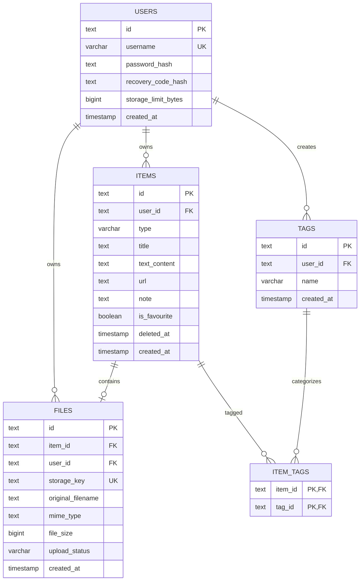

# QuickVault: Technical Architecture & System Design

This document details the software architecture, data flow, database schema, security boundaries, and infrastructure integration of QuickVault.

---

## 1. System Overview & Technology Stack

QuickVault is built as a single-repository full-stack Next.js web application utilizing the React Server and Client Components architecture (App Router) with Turbopack.



### 1.1 Core Technologies in Use

| Tier | Technology | Justification & Role |
|---|---|---|
| **Frontend Framework** | Next.js 16.4.2 (App Router), React 19.3.0 | Server and Client components, route-based API handling, streaming, and fast build output with Turbopack. |
| **Language** | TypeScript 5 | Strict static typing across database models, API payloads, and UI props. |
| **Styling** | Tailwind CSS v4 | Utility-first styling with CSS custom variables for iOS design tokens (light and dark mode). |
| **Icons** | Lucide React | Minimal monochrome iconography consistent with modern iOS and macOS design. |
| **Validation** | Zod 3 | Schema validation for all incoming API request bodies and query parameters. |
| **Authentication** | Custom Bcrypt + JOSE (JWT) | Salted password hashing (12 rounds) with timing-safe comparison; signed JWT tokens stored in HTTP-only, SameSite=Lax cookies. No Google OAuth or third-party tracking. |
| **Database Adapter** | PostgreSQL (`pg` 8.23.1) & `@libsql/client` 0.18.0 | Supabase PostgreSQL connection pool with global pool caching for serverless hot reloads, with embedded SQLite fallback for local offline testing. |
| **Object Storage** | AWS S3 SDK (`@aws-sdk/client-s3`, `@aws-sdk/s3-request-presigner`) | S3-compatible integration for Cloudflare R2 presigned PUT/GET URLs; private default buckets. |
| **Migrations** | Custom Migration Runner (`scripts/migrate.mjs`) | Non-destructive schema migration runner tracking versions in `_migrations` table for both PostgreSQL and SQLite. |

---

## 2. Persistent Storage Architecture & Production Safeguards

### 2.1 Storage Modes & Locations
1. **Local Mode (Default in development & test)**:
   - **Database**: Single-file SQLite database at `.data/quickvault.db` via `@libsql/client`.
   - **Files**: Stored on disk under `.data/uploads/users/{userId}/{itemId}/{uuid}-{filename}`.
   - **Longevity**: Data persists across application restarts and OS reboots on a local machine.
2. **Production Mode (`NODE_ENV === 'production'`)**:
   - **Database**: Managed PostgreSQL hosted on Supabase connected via connection pooling URI (`DATABASE_URL`).
   - **Files**: Cloudflare R2 private bucket accessed via S3 presigned PUT/GET URLs.

### 2.2 Production Safeguards (`src/lib/env-config.ts`)
To prevent silent data loss or read-only filesystem crashes (`EROFS`) on ephemeral serverless platforms (e.g. Vercel, AWS Lambda), QuickVault enforces runtime configuration validation:
- In `NODE_ENV === 'production'`, `validateStorageConfig()` verifies that `DATABASE_URL` is set and begins with `postgres://` or `postgresql://`.
- In `NODE_ENV === 'production'`, it verifies that `R2_ACCOUNT_ID`, `R2_ACCESS_KEY_ID`, and `R2_SECRET_ACCESS_KEY` are defined.
- If any required variable is missing, it immediately throws `ConfigurationError` listing precisely which variables are required without exposing secret tokens or connection passwords.
- In production, local storage endpoints (`/api/storage/local-upload` and `/api/storage/local-file/[...key]`) return HTTP 403 Forbidden.
- Deletion operations use unified helper `deleteStorageFile()` in `src/lib/r2.ts` to keep storage objects and database records strictly synchronized.

---

## 3. Database Schema & Migration Architecture

### 3.1 Migration Workflow
- Migration files are stored in `supabase/migrations/` (e.g. `001_initial_schema.sql`).
- Schema tracking table `_migrations (id, name, applied_at)` records every applied script.
- Commands:
  - `npm run migrate:status`: Inspects pending and applied migrations.
  - `npm run migrate`: Connects to `DATABASE_URL` and executes unapplied migrations inside a transaction.

### 3.2 Schema Definition


---

## 4. Cloudflare R2 Configuration & Direct Browser Upload Flow

### 4.1 Bucket Privacy & Presigned URLs
1. **Private by Default**: Cloudflare R2 buckets are not publicly accessible; public bucket access is disabled.
2. **Presigned Upload URL**: Client requests `POST /api/storage/upload-url` with file metadata. The server issues a short-lived (15-minute) presigned `PUT` URL.
3. **Direct Upload**: Browser uploads the binary payload directly to Cloudflare edge via `PUT`. Server bandwidth is untouched.
4. **Verification Step**: Client notifies `POST /api/storage/confirm`. The server calls `HeadObjectCommand` to verify object presence and size before creating database records.
5. **Presigned Download URL**: When viewing an item, the server generates a time-limited (30-minute) presigned `GET` URL only after verifying the user owns the item.

### 4.2 Required Cloudflare R2 CORS Configuration
To allow direct browser uploads from your QuickVault domain, apply this CORS policy to your R2 bucket in the Cloudflare Dashboard:
```json
[
  {
    "AllowedOrigins": [
      "https://your-quickvault-domain.com",
      "http://localhost:3000",
      "http://localhost:3005"
    ],
    "AllowedMethods": [
      "GET",
      "PUT",
      "HEAD"
    ],
    "AllowedHeaders": [
      "*"
    ],
    "ExposeHeaders": [
      "ETag"
    ],
    "MaxAgeSeconds": 3600
  }
]
```
